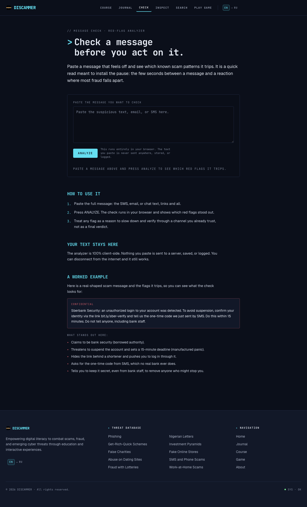
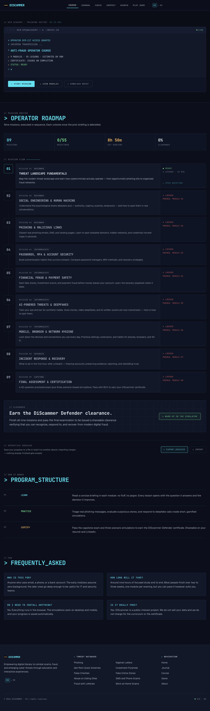
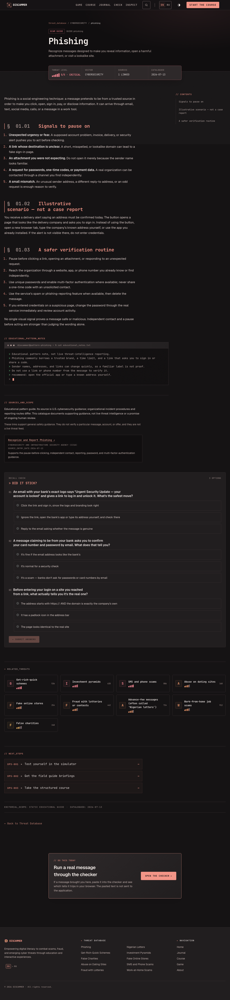
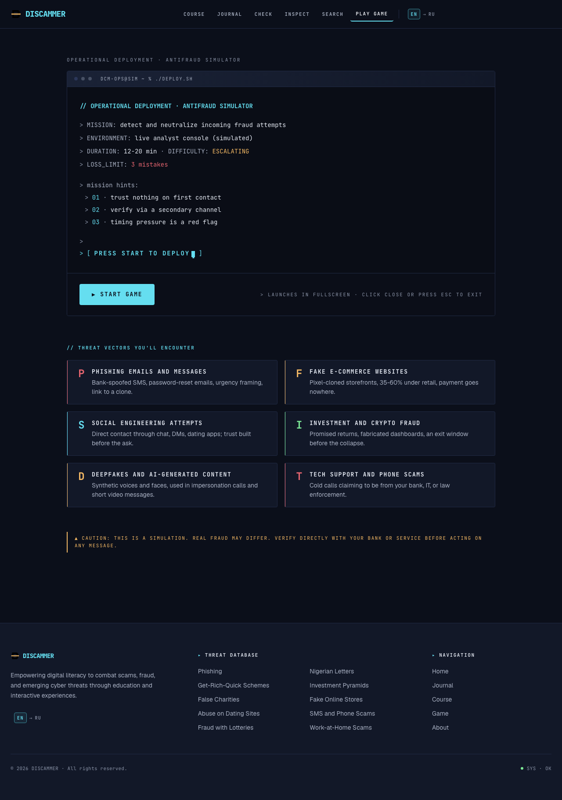

# DiScammer

A bilingual (English / Russian), privacy-conscious anti-scam learning platform.
DiScammer helps a reader pause, inspect a suspicious message or link, and learn
the recognition patterns behind phishing, social engineering, financial fraud,
account security, AI-enabled deception, and incident response.

| Home | Message checker |
| --- | --- |
|  |  |

| Course | Scam guide | Antifraud Hero game |
| --- | --- | --- |
|  |  |  |

## What it includes

- **Ten scam-type guides**, each mapped to one or three official primary
  sources in a static, reviewable catalogue (`content/provenance/`).
- **A nine-module course** with file-driven lessons. Progress is browser-local
  by default; learners may opt into sync, which stores a copy on the server —
  encrypted in the browser under a key derived from a code the server never
  receives, so the stored copy is ciphertext the server cannot read.
- **Two in-browser checking tools** — a message checker and a link inspector.
  Their analysis runs entirely client-side: input is not sent to any DiScammer
  analysis API. The backend ships only a versioned threat-rules feed (host and
  TLD lists) that feeds the in-browser engines.
- **An educational journal archive** — interviews, newsletters, and articles —
  with full-text search.
- **[Antifraud Hero](https://github.com/FomaMol/antifraud-hero)** — a Unity
  WebGL game about spotting fraud, embedded at `/play/`.

## Engineering notes

- **Server-rendered pages** (FastAPI + Jinja) with **23 lazy-hydrated React
  islands** (Vite, TypeScript). The server HTML is retained as the suspense and
  error fallback so an island failure never turns a reading surface into a
  blank box.
- **SQLite content store** derived from Markdown files with flat front matter
  under `content/` — guides, posts, and course metadata are plain text in git.
- **Playwright visual E2E suite** with committed snapshots across EN/RU and
  desktop/mobile; the images above are those snapshots.
- **Docker-based deployment** behind Cloudflare: Prometheus metrics gated by
  bearer token or loopback, CSP report sink, client-error beacon.
- **Service worker** with a deliberate anti-stale caching contract (documents
  network-first, hashed assets cache-first, API and game bundle never
  intercepted) and a JavaScript-free offline fallback.
- **SEO surface**: robots, sitemap, RSS feed, web manifest, IndexNow key file.

## Repository layout

```
backend/    FastAPI app: SSR pages, /api content + threat-rules feed, game mount
frontend/   React islands, Vite build into backend/static/, service worker source
content/    Markdown guides/posts and course lesson data (source of truth)
deploy/     Docker Compose stacks, nginx config, AWS migration notes
e2e/        Playwright visual regression suite + committed snapshots
docs/       Design documents, operations runbooks, portfolio dossier
scripts/    Maintenance, load testing, i18n audit tooling
```

## Local development

```bash
# Backend tests
python -m pip install -r requirements.txt pytest httpx
pytest -q

# Frontend tests and production build (output lands in backend/static/)
cd frontend
npm ci
npm test
npm run build
```

For the full technical overview, contributor workflow, and documentation map,
see [PROJECT.md](PROJECT.md). The portfolio dossier lives at
[docs/portfolio/README.md](docs/portfolio/README.md) and is published on the
site under `/en/portfolio` and `/ru/portfolio`.
